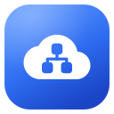

<p align="center">
  
</p>

<h1 align="center">Auto Update Cloud Firewall</h1>

<p align="center">
  <a href="README.md">English</a> ·
  <a href="README.zh-CN.md">简体中文</a> ·
  <a href="README.ja.md">日本語</a> ·
  <a href="README.ko.md">한국어</a>
</p>

클라우드 보안 그룹의 인바운드 규칙이 항상 현재 공인 IPv4 주소를 가리키도록 유지해 주는
작은 데스크톱 앱입니다. 알림 영역에서 조용히 실행되며 일정 간격으로 IP를 다시 확인하고,
자신이 관리하는 규칙만 갱신합니다. 보안 그룹의 나머지 설정은 전혀 건드리지 않습니다.

Rust와 [gpui-kit](https://gpui-kit.com/docs/getting-started/)으로 만들었습니다.

## 지원 클라우드

| 공급자 | API | 사용하는 작업 |
| --- | --- | --- |
| Aliyun ECS | RPC, `ecs.aliyuncs.com`, `2014-05-26` | `DescribeSecurityGroups`, `DescribeSecurityGroupAttribute`, `AuthorizeSecurityGroup`, `RevokeSecurityGroup`, `ModifySecurityGroupRule` |
| Tencent Cloud CVM | TC3-HMAC-SHA256, `ecs.tencentcloudapi.com`, `2017-03-12` | `DescribeSecurityGroups`, `DescribeSecurityGroupPolicies`, `CreateSecurityGroupPolicies`, `DeleteSecurityGroupPolicies` |

클라우드 공급자 SDK는 사용하지 않으며, 두 요청 서명기를 직접 구현했습니다.

## 기능

- **여러 계정과 보안 그룹.** Aliyun 또는 Tencent Cloud 계정을 원하는 만큼 추가하고,
  각 계정에 자체 AccessKey와 리전을 지정한 뒤 하나 이상의 보안 그룹 대상을 연결할 수 있습니다.
- **공인 IP 자동 감지.** 여러 HTTP 조회를 순서대로 시도합니다(기본값: ipify, ifconfig.me,
  ipinfo.io, ipip.net). 사설, 루프백, 링크 로컬, CGNAT, 멀티캐스트, 예약된 IPv4 대역은
  거부됩니다.
- **안전한 규칙 소유권.** 설명이 설정한 접두사(기본값 `AutoFirewall`)로 시작하는 인바운드
  규칙만 생성, 변경, 삭제됩니다. 직접 만든 규칙은 절대 수정되지 않습니다.
- **드라이런 모드.** 쓰기 API를 호출하지 않고 계획된 변경만 기록합니다.
- **백그라운드 실행.** 창을 닫아도 앱은 트레이에 남아 있고, 창이 숨겨진 동안에도 워커가 계속
  동기화합니다. Windows 시작 시 자동 실행을 선택적으로 켤 수 있습니다.
- **활동 로그.** 최근 500개 항목을 UI에 표시하고, 전체 로그는 디스크에 추가로 기록됩니다.
- **네 가지 인터페이스 언어.** 영어, 중국어 간체, 일본어, 한국어. 첫 실행 시 Windows 표시
  언어를 따르며, 이후 **설정 → 언어**에서 언제든지 전환할 수 있습니다. UI, 대화상자, 트레이
  메뉴, 새 로그 메시지에 즉시 적용됩니다.

## 요구 사항

- Windows 10/11(트레이, 자격 증명 저장소, 자동 실행 연동에 Win32 사용).
- Rust 1.85 이상(edition 2024)과 MSVC 툴체인.
- 보안 그룹을 읽고 수정할 수 있는 AccessKey:

  **Aliyun** — `ecs:DescribeSecurityGroups`, `ecs:DescribeSecurityGroupAttribute`,
  `ecs:AuthorizeSecurityGroup`, `ecs:RevokeSecurityGroup`,
  `ecs:ModifySecurityGroupRule`.

  **Tencent Cloud** — `DescribeSecurityGroups`, `DescribeSecurityGroupPolicies`,
  `CreateSecurityGroupPolicies`, `DeleteSecurityGroupPolicies`.

루트 계정 대신 앱 전용 RAM/CAM 사용자를 사용하세요.

## 빌드 및 실행

```powershell
cargo run --release
```

디버그 빌드(`cargo run`)는 진단용 콘솔 창이 함께 열립니다. 릴리스 빌드는 GUI만 있습니다.

테스트 실행:

```powershell
cargo test
```

## 릴리스

```powershell
pwsh tools/release.ps1 -Version 1.0.0           # 빌드 후 플랫폼별로 이름 지정
pwsh tools/release.ps1 -Version 1.0.0 -Publish  # GitHub Release까지 생성
```

산출물은 `dist/`에 플랫폼 접미사가 붙은 이름으로 저장됩니다:
`auto-update-cloud-firewall-x86_64-windows.exe`,
`auto-update-cloud-firewall-x86_64-darwin`,
`auto-update-cloud-firewall-x86_64-linux`.
스크립트는 빌드 전에 `cargo fmt --check`, clippy, 테스트를 실행하며, 릴리스 노트는
`docs/releases/<버전>.md`(4개 언어)에서 가져옵니다. 각 플랫폼 바이너리는 해당 시스템
또는 CI에서 빌드해야 합니다.

실제 릴리스는 CI로 진행합니다. `v*` 태그를 push하면
`.github/workflows/release.yml`이 Windows, macOS, Linux 러너에서 각각 빌드하고 세 산출물과
`docs/releases/<버전>.md`를 함께 Release에 첨부합니다. macOS와 Linux 산출물은 릴리스 노트에
**미검증**으로 표시됩니다.

변경 이력은 [CHANGELOG.ko.md](CHANGELOG.ko.md)를 참고하세요.

## 앱 사용 방법

1. **클라우드 계정**을 열고 **Aliyun 계정** 또는 **Tencent Cloud 계정**으로 계정을
   추가합니다. AccessKey 시크릿은 서비스 이름 `AutoUpdateCloudFirewall`로 Windows 자격 증명
   관리자에 기록되며, `config.json`에는 절대 기록되지 않습니다.
2. 계정에 **보안 그룹** 대상을 추가합니다. 이름, 보안 그룹 ID, 선택적 리전 재정의, 그리고
   인바운드 규칙 한 줄에 하나씩(프로토콜, 포트 또는 `8000-8010` 같은 범위, 선택적 설명
   키워드) 지정합니다.
3. 앱은 트레이에 그대로 두면 됩니다. `check_interval_secs`(기본값 300, 최소 60)마다 공인 IP를
   확인하고 주소가 바뀌면 동기화합니다. **지금 동기화**로 강제 실행하고, **IP 감지**로 주소를
   즉시 갱신할 수 있습니다.
4. 트레이 메뉴: **창 표시**, **창 숨기기**, **지금 동기화**, **구성 폴더 열기**, **종료**.
   아이콘을 두 번 클릭하면 창이 표시됩니다.
5. **설정 → 언어**에서 English, 简体中文, 日本語, 한국어 중 하나를 고릅니다. 선택한 값은
   `settings.language`(`en`, `zh-CN`, `ja`, `ko`)에 저장됩니다.

## 동기화 동작 방식

활성화된 대상마다:

1. 클라우드 API에서 현재 인바운드 규칙을 읽습니다.
2. 대상의 규칙과 감지된 공인 IP로 원하는 규칙 집합을 만듭니다. 모든 규칙에는 설명이 붙고,
   키워드를 입력한 줄은 키워드도 함께 기록합니다.
3. 먼저 **삭제**합니다. 설명이 `AutoFirewall`로 시작하고 더 이상 일치하지 않는 오래된 규칙을
   하나씩 삭제합니다(Tencent Cloud의 규칙 인덱스가 유효하게 유지됩니다). 이 단계는 갱신보다
   먼저 와야 합니다. Aliyun은 다른 규칙과 완전히 중복되는 상태로의 변경을 거부하며
   (`InvalidOperation.RuleDuplicate`), 오래된 규칙이 새 IP를 점유하고 있는 경우가 많습니다.
4. 줄에 **설명 키워드**가 있으면 프로토콜과 포트가 같고 설명에 그 키워드가 포함된 규칙을
   인수하여 **원본 IP를 그 자리에서 교체합니다**(Aliyun은 `ModifySecurityGroupRule`). 설명과
   우선순위는 그대로 유지됩니다. 규칙 단위 수정 API가 없는 Tencent Cloud에서는 같은 설명으로
   삭제한 뒤 다시 만듭니다. 키워드가 여러 규칙과 일치하면 추측하지 않고 대상 전체를 오류로
   건너뜁니다.
5. 마지막으로 빠진 규칙을 생성합니다. 키워드가 없는 줄은 기존처럼 접두사로 관리합니다.
6. 그룹을 다시 읽어 계획된 규칙이 남아 있지 않은지 확인합니다.

직접 만든 규칙은 해당 줄을 설정에서 삭제해도 절대 삭제되지 않습니다.

쓰기 호출은 짧은 백오프와 함께 최대 3회 재시도합니다. 오류는 기록되고 백그라운드 루프를
멈추지 않은 채 UI에 표시됩니다.

## 파일

| 경로 | 용도 |
| --- | --- |
| `%APPDATA%\AutoUpdateCloudFirewall\config.json` | 계정, 대상, 설정. 시크릿은 포함하지 않습니다. |
| `%LOCALAPPDATA%\AutoUpdateCloudFirewall\logs\app.log` | 추가 전용 활동 로그. |
| Windows 자격 증명 관리자, 서비스 `AutoUpdateCloudFirewall` | AccessKey 시크릿, 계정 ID당 하나의 항목. |

`config.json.example`에 디스크 형식이 설명되어 있습니다. 편집에는 GUI 사용을 권장합니다.
파일이 손상되면 `config.json.broken`으로 백업되고 다음 시작 시 기본값으로 교체됩니다.

## 프로젝트 구조

| 파일 | 역할 |
| --- | --- |
| `src/main.rs` | 런타임, 채널, 트레이 및 창 부트스트랩. |
| `src/i18n.rs` | 영어 / 중국어 간체 / 일본어 / 한국어 문자열. |
| `src/model.rs` | 계정·대상·설정 타입, 포트 파싱과 서식 지정. |
| `src/storage.rs` | 설정 읽기/쓰기와 자격 증명 저장소 접근. |
| `src/ip.rs` | 공인 IPv4 감지와 검증. |
| `src/planner.rs` | 원하는 규칙과 원격 규칙의 차이 계산, 관리 대상 규칙 선택. |
| `src/providers/` | Aliyun RPC와 Tencent TC3 클라이언트 및 서명. |
| `src/worker.rs` | 백그라운드 루프, 재시도, 검증, 계정 테스트. |
| `src/platform.rs` | 네이티브 창 표시/숨기기, Windows 자동 실행. |
| `src/tray.rs` | 알림 영역 아이콘과 메뉴. |
| `src/ui/` | 사이드바 셸, 페이지, 계정/대상 대화상자. |
| `assets/` | 아이콘 원본(`logo.svg`, `logo-compact.svg`, `logo-mono.svg`, `logo-ui.svg`)과 생성된 PNG/ICO. |
| `tools/generate-icons.py` | SVG 원본에서 아이콘 세트를 다시 생성합니다. |
| `build.rs` | 실행 파일 아이콘과 버전 리소스를 포함합니다. |

## 제한 사항

- IPv4만 지원합니다.
- 인바운드 규칙만 다룹니다.
- 규칙은 설명 접두사로 매칭됩니다. 직접 만든 규칙을 앱이 건드리지 않게 하려면 해당 접두사를
  수정하지 마세요.

## 링크

- 공식 사이트: [rustsilk.com](https://rustsilk.com)

## 라이선스

이 프로젝트는 [MIT 라이선스](LICENSE)로 배포됩니다.

Copyright (c) 2026 Auto Update Cloud Firewall contributors.
